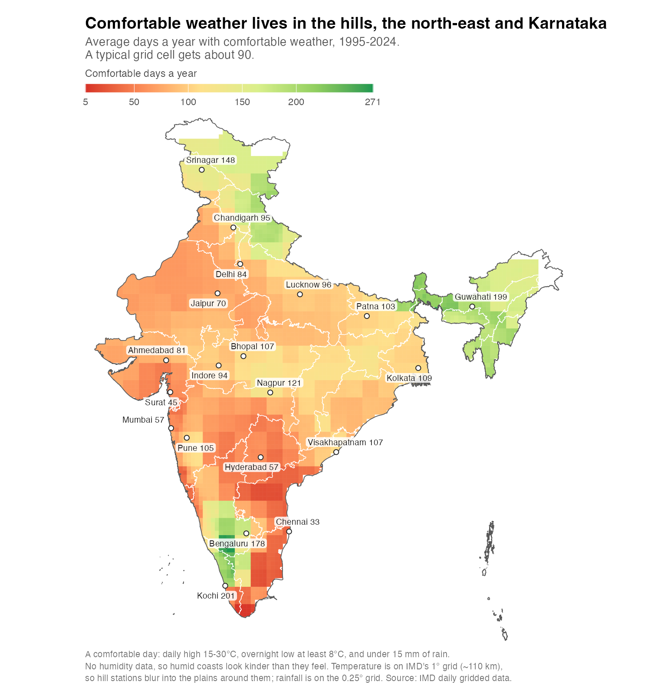
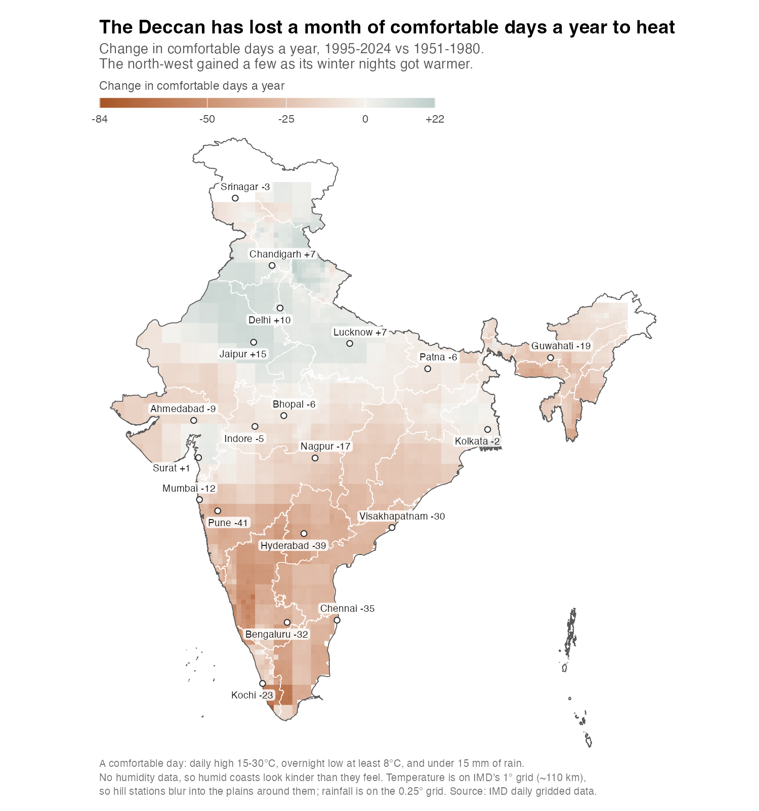
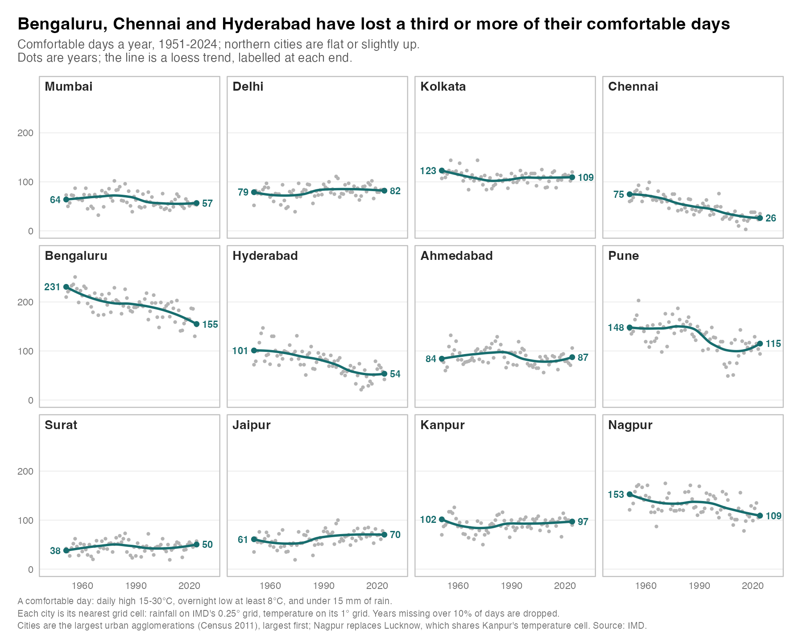

# India daily gridded rainfall and temperature → Parquet

Scripts to turn the India Meteorological Department's 0.25° daily gridded
rainfall archive (NetCDF, one file per year, 1901–2025) into a tidy,
year-partitioned Parquet dataset, plus a mapping from IMD grid cells to Indian
towns and cities.

Also includes IMD's 1° daily minimum/maximum temperature archive, 1951–2025,
converted to a separate year-partitioned Parquet dataset (see below).

On top of the data sit a few analyses: how many "comfortable" days each part of
India gets and how that has changed since 1951, rainfall in the Kaveri basin,
and Hurst-style persistence of city rainfall. Write-ups:

- [`blog-comfortable-weather.md`](blog-comfortable-weather.md) - comfortable days across India
- [`blog-post.md`](blog-post.md) - a century of rain in the Kaveri basin

**No raw data is shipped in this repo** - only code, notebooks and rendered
charts (`outputs/`). See [Data & licensing](#data--licensing) for why, and how
to fetch the data yourself. Changes are listed in [`CHANGELOG.md`](CHANGELOG.md);
how it was built is in [`dev-log.md`](dev-log.md).



## Repository layout

| Path | What it is |
|---|---|
| `scripts/` | Download, conversion and build scripts, plus the comfort chart scripts. Run from the repo root. |
| `explore_rainfall.Rmd` | Notebook: first look at the rainfall grid, the monsoon curve, 2025, and nine-city rainfall trends |
| `hurst_rainfall.Rmd` | Notebook: Hurst's rescaled range on nine cities' annual rainfall - how big a reservoir each would need |
| `kaveri_rainfall.Rmd` | Notebook: Kaveri basin and dam-catchment rainfall |
| `outputs/` | Rendered charts (committed) |
| `data/`, `*_parquet/`, `sources/` | Built or downloaded data - gitignored, rebuilt by the scripts |
| `blog-*.md`, `dev-log.md`, `CHANGELOG.md` | Write-ups and project history |

The notebooks are meant to be run chunk by chunk in RStudio or Positron, after
the data has been built; they are not knitted.

## What the scripts produce

Run end to end and you get:

| Output | Rows | Size | Built by |
|---|---|---|---|
| `rainfall_parquet/year=YYYY/data.parquet` | 226.6M (all years) | ~400 MB | `scrape.py` |
| `city_cell_mapping.parquet` | 557,995 places → cells | ~10 MB | `citymap.py` |
| `cell_lookup.parquet` | 4,964 cells, one biggest town each | small | `build_cell_lookup.R` |

The rainfall table is long/tidy: `date, lat, lon, rainfall_mm` (+ `year` from
the partition folder). One row per land grid cell per day. Ocean and
out-of-India cells (IMD `_FillValue = -999`) are dropped, which is what shrinks
each 25 MB NetCDF year to ~3.5 MB of Parquet.

## The grid

- 0.25° × 0.25°, 135 longitudes × 129 latitudes, first point at 6.5°N / 66.5°E,
  last at 38.5°N / 100.0°E.
- 4,964 of those ~17,000 grid points sit over Indian land and carry data.
- Each cell is roughly 28 × 28 km — district-sized, not a single town. A cell
  can hold many towns (the Bengaluru cell contains 513 named places) or none
  (457 cells are desert, high Himalaya or dense forest with no named place).

## Setup

Python side (download + NetCDF → Parquet), using [uv](https://docs.astral.sh/uv/):

```bash
uv pip install --python /Users/Karthik/envs/datascience/.venv/bin/python xarray netCDF4 pandas pyarrow
```

R side (lookup table + charts) needs `arrow`, `dplyr`, `lubridate`, `ggplot2`.
The Kaveri and comfortable-days analyses additionally use `sf`, `duckdb`, `DBI`
and `ggrepel` (Kaveri also uses `trend`). `explore_rainfall.Rmd` uses `ellmer`
to have a model describe each city's rainfall trend, and needs `OPENAI_API_KEY`
set in `.Renviron`.

## Run it

```bash
# 1. Download all years 1901–2025 and convert to rainfall_parquet/
#    Resumable: re-running skips years already converted. Deletes each .nc
#    after converting. ~30–45 min, ~3 GB downloaded, polite 2 s delay.
/Users/Karthik/envs/datascience/.venv/bin/python scripts/scrape.py

# 2. Map Indian populated places (GeoNames) to their grid cell.
#    Needs IN.txt + admin1.txt (see below).
/Users/Karthik/envs/datascience/.venv/bin/python scripts/citymap.py

# 3. Label each cell with its largest town.
Rscript scripts/build_cell_lookup.R
```

For the place mapping, grab the GeoNames dumps first:

```bash
curl -sL https://download.geonames.org/export/dump/IN.zip -o IN.zip && unzip IN.zip IN.txt
curl -sL https://download.geonames.org/export/dump/admin1CodesASCII.txt -o admin1.txt
```

Pipeline scripts live in `scripts/`; run them from the repo root (paths are
root-relative).

## Using the data

Rainfall for any city, across all 125 years — join through the cell lookup:

```r
library(arrow); library(dplyr)

cell <- read_parquet("cell_lookup.parquet") |> filter(name == "Bengaluru")

open_dataset("rainfall_parquet") |>
  filter(lat == cell$cell_lat, lon == cell$cell_lon) |>
  collect()
```

`open_dataset()` is lazy — filters push down to the Parquet files, so pulling
one cell out of 226M rows is quick.

## Daily gridded temperature

`scripts/download_temperature.py` downloads IMD's daily minimum and maximum
temperature archive, 1951–2025, on its 1° × 1° grid. Both live download selectors
offered 2025 when checked on 11 October 2026, although the descriptive text still
said 1951–2024. The status of the 2025 temperature release is not specified there.

```bash
/Users/Karthik/envs/datascience/.venv/bin/python scripts/download_temperature.py
# To fetch or resume a smaller interval:
/Users/Karthik/envs/datascience/.venv/bin/python scripts/download_temperature.py --start-year 2024 --end-year 2025
```

Dependencies: `numpy`, `pandas`, `pyarrow`, and `requests`, installed in the central
Python environment. Paths resolve relative to the script, so any working directory
is supported. Existing Parquet years are skipped; failed years are reported and
can be retried with the same command.

The completed 1951–2025 download contains 9,625,751 cell-days across 75 Parquet
files (43.5 MB), covering all 27,394 dates and 362 distinct grid points over the
period. Each year's cell-day keys were checked for uniqueness. The 150 original
binary files occupy 210.6 MB. Coverage varies by cell and day: 1,025 retained
rows lack Tmin and 2,659 lack Tmax.

Three source rows have Tmin > Tmax and are retained unchanged: 25 May 2009 at
(21.5°N, 87.5°E) and (21.5°N, 88.5°E), and 3 May 2019 at (21.5°N, 88.5°E).
Exclude or investigate these explicitly when calculating daily temperature range.

- Canonical analytical output: `temperature_parquet/year=YYYY/data.parquet`,
  with `date`, `lat`, `lon`, `tmin_c`, `tmax_c`; partition directory supplies `year`.
  The intended unique key is `(date, lat, lon)`, checked before each atomic write.
- Original downloads: `sources/temperature/{mintemp,maxtemp}_YYYY.grd`, retained
  to allow rebuilding without depending on the intermittently slow IMD server.
- Binary layout: little-endian float32, day then latitude then longitude;
  31 latitudes from 7.5°N to 37.5°N, 31 longitudes from 67.5°E to 97.5°E.
  IMD's `99.9` missing sentinel becomes null. Grid-days with both values missing
  are omitted; partially missing observations and Tmin > Tmax are retained and
  reported. File sizes, dates, physical bounds, and unique keys are checked.
- This grid is coarser than the rainfall grid; the rainfall town lookup should
  not be reused as a temperature lookup without spatial remapping.
- IMD notes that 2008 onward uses fewer stations (around 180), affecting
  interpretation of trends across that change.

Sources: [maximum temperature](https://www.imdpune.gov.in/cmpg/Griddata/Max_1_Bin.html)
and [minimum temperature](https://www.imdpune.gov.in/cmpg/Griddata/Min_1_Bin.html).
The script POSTs the year to `maxtemp.php` or `mintemp.php`, as their forms do.
Data remain © IMD and are excluded from Git. IMD requests the citation:
Srivastava, Rajeevan & Kshirsagar (2009), *Development of High Resolution Daily
Gridded Temperature Data Set (1969–2005) for the Indian Region*,
[doi:10.1002/asl.232](https://doi.org/10.1002/asl.232).

## Comfortable days

A day counts as comfortable when the daily high is 15-30°C, the overnight low is
at least 8°C, and rainfall is under 15 mm (the top of IMD's "light rain" band).
There is no humidity in the IMD data, so humid coasts look kinder than they feel.

```bash
# Needs rainfall_parquet/ and temperature_parquet/ (above), and the India state
# boundaries in sources/boundaries/, which the Kaveri fetch script downloads.
bash scripts/fetch_kaveri_geography.sh

Rscript scripts/build_comfortable_days.R   # ~2 min, writes the daily flags
Rscript scripts/map_comfortable_days.R     # the two maps
Rscript scripts/plot_city_comfort_trends.R # the 12-city panels
```

The rule was chosen to be India-specific. The US-style definition the idea came
from (60-87°F high, dew point at most 60°F, cloud cover at most 50%) doesn't
travel: in India a cloudy day is usually a relief, and IMD's gridded data has no
humidity or cloud. So rain stands in for cloud, and the 30°C ceiling does some
of humidity's work by screening out the muggy coasts.

The build script writes `comfort_parquet/year=YYYY/`, one row per 0.25° rainfall
cell per day, 1951-2025 (136M rows). Each rainfall cell takes the temperature of
the 1° cell it sits in; 60 coastal and border cells with no 1° cell above them take
the nearest one and are flagged `temp_from_neighbour`. `comfortable` is NULL when
any input is missing that day. It also writes `data/comfortable_days_annual.parquet`
(days, observed days and comfortable days per cell per year). The thresholds are
at the top of the script.

The map script draws the 1995-2024 average and the change since 1951-1980 into
`outputs/`, clipped to India's official boundary (DataMeet state outlines via
geoBoundaries), dropping cells missing more than 10% of days in a period.
`scripts/plot_city_comfort_trends.R` plots yearly counts with a loess trend for
the largest cities (Census 2011 urban agglomerations; Nagpur replaces Lucknow,
which shares Kanpur's 1° temperature cell).

| Chart | Hard rule | Fuzzy score |
|---|---|---|
| Average, 1995-2024 | `outputs/comfortable_days_map.png` | `outputs/comfortable_days_map_fuzzy.png` |
| Change since 1951-1980 | `outputs/comfortable_days_change_map.png` | `outputs/comfortable_days_change_map_fuzzy.png` |
| City trends | `outputs/city_comfortable_days.png` | `outputs/city_comfortable_days_fuzzy.png` |





### Fuzzy comfort score

The hard rule calls 30.0°C comfortable and 30.1°C not. Each day also gets a
`comfort_score` between 0 and 1: every threshold becomes a logistic curve that
is 0.5 at the hard cut-off and fades over a few degrees (or, for rain, on a log
scale), and the day's score is the product of the four. Read it as the share of
people whose own cut-offs the day clears. Summed over a year it gives expected
comfortable days (`comfort_score_days` in the annual table, over
`score_observed_days`). The curve widths sit at the top of the build script.

```bash
Rscript scripts/map_comfortable_days.R fuzzy
Rscript scripts/plot_city_comfort_trends.R fuzzy
```

These write the same charts with a `_fuzzy` suffix.

Caveats specific to this analysis:

- Temperature is on a 1° grid (~110 km), so hill stations blur into the plains
  around them. Shillong's cell has a median high of 29°C; Kochi's cell takes in
  the Western Ghats and scores far higher than the city would.
- No humidity, so the humid coasts look kinder than they feel.
- IMD's temperature coverage changes over time (some J&K, Arunachal and island
  cells only from 1969), and its station count drops from 2008.

## Kaveri catchment analysis

`kaveri_rainfall.Rmd` maps the Kaveri basin to the IMD grid, then compares
area-weighted monthly and annual rainfall for the whole basin, the Karnataka
portion, and catchments upstream of major dams and gauges. Tributaries are
included through HydroBASINS upstream topology rather than a buffer around the
main river.

Download the external CWC/NWIC, HydroBASINS, HydroRIVERS, and geoBoundaries
files, then build the geography and rainfall aggregates:

```bash
bash scripts/fetch_kaveri_geography.sh
Rscript scripts/build_kaveri_geography.R
Rscript scripts/aggregate_kaveri_rainfall.R
```

The build script creates fractional grid-cell weights for the whole basin and
for Harangi, Hemavathi, KRS, Kabini, Biligundlu, Mettur, Bhavanisagar, and
Amaravathi. The second scans the year-partitioned rainfall Parquet with DuckDB
and writes compact monthly and annual aggregates under `data/`.

The external geometries and derived rainfall tables remain untracked; the
rendered charts are in `outputs/kaveri_*.png`. See [`blog-post.md`](blog-post.md)
for the findings and caveats.

## Exploration and Hurst notebooks

`explore_rainfall.Rmd` is the first look at the rainfall grid: coverage, the
all-India monsoon curve with 2025 against the other 124 years, a century of
annual totals, the 2025 rainfall map, and nine-city trends since 1951.

`hurst_rainfall.Rmd` borrows Harold Edwin Hurst's question about the Nile - how
much storage does it take to release the average every year - and applies the
rescaled range (R/S) to nine cities' annual rainfall, 1951-2024. It reports the
Hurst exponent and the storage needed in years of average rainfall. Pune's
storage figure is driven by a strong trend in its cell rather than persistence,
and is flagged as such in the notebook.

## Data & licensing

The **code** in this repo is MIT (see `LICENSE`). The **data is not**, and is
deliberately not committed here. The charts in `outputs/` are aggregates
derived from IMD data and carry IMD as their source.

- **Rainfall** — © India Meteorological Department, Pune. High-resolution
  (0.25°) daily gridded rainfall, 1901–2024 (final) + 2025 (real-time /
  provisional). Download the yearly NetCDF files from
  <https://www.imdpune.gov.in/cmpg/Griddata/Rainfall_25_NetCDF.html>. Use is
  subject to IMD's data-supply terms — check them before you redistribute
  anything derived from it.
- **Temperature** — © India Meteorological Department, Pune. 1° daily gridded
  minimum and maximum temperature, 1951–2025 (see the temperature section).
- **Place names** — from [GeoNames](https://www.geonames.org/), licensed
  CC BY 4.0. The `IN.zip` / `admin1CodesASCII.txt` dumps are downloaded by you,
  not bundled here.
- **State boundaries** — DataMeet India maps via geoBoundaries
  (`IND-ADM1`), CC BY 2.5 IN, downloaded by `scripts/fetch_kaveri_geography.sh`.

If you only want the code, you have it. If you want the data, the scripts fetch
it for you.

## Caveats worth knowing

- **A cell is not a town.** ~28 km cells; the "largest town per cell" label is a
  convenience, not a gauge reading. Suburbs share their city's cell.
- **1,706 coastal/island places** don't fall inside a data cell and are snapped
  to the nearest one (median snap 10.6 km; a handful of island points are far
  further — check `dist_km` if precision matters).
- **Dates print in IST.** Values are stored at midnight UTC, so R may show
  `05:30:00`. They're daily totals — wrap with `as.Date()`.
- **2025 is provisional.** Treat the current year as real-time data that may be
  revised; 1901–2024 are the final series.
