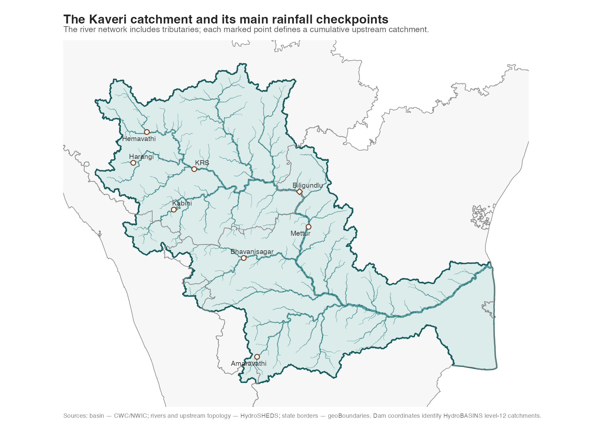
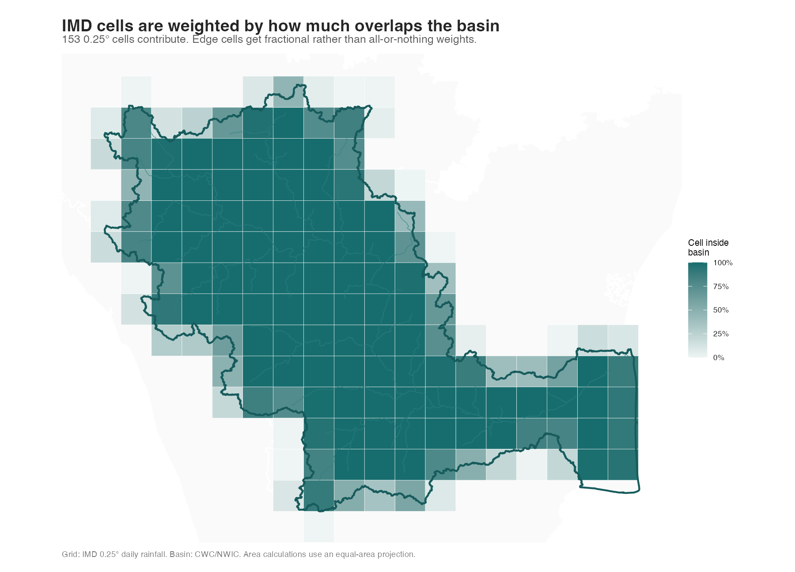
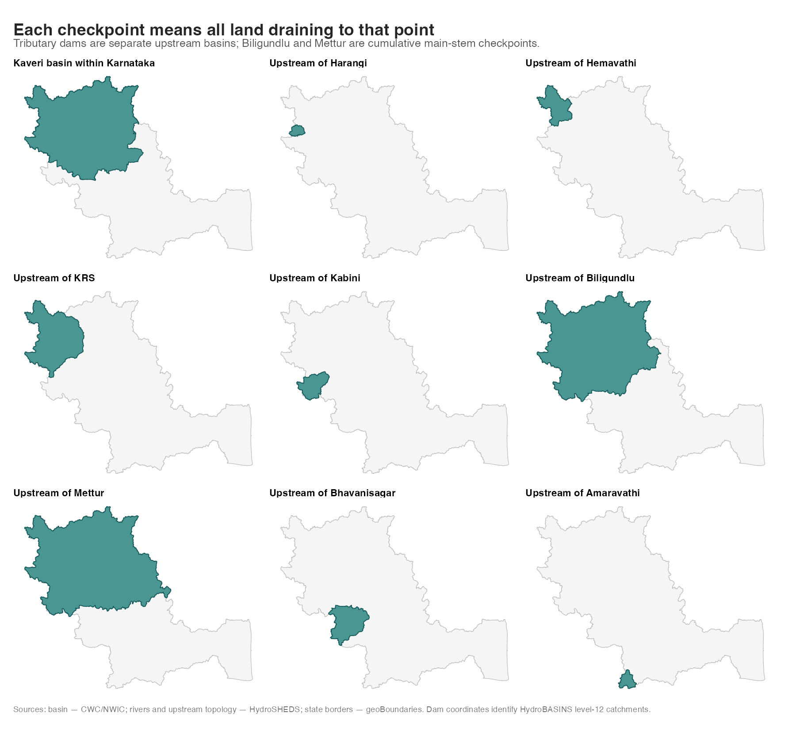

```{r}
require(tidyverse)
require(arrow)
require(lubridate)
require(ggrepel)
```

What exactly are we measuring?

- A year means a calendar year. We can add the June-May water year later.
- "Rainfall in the catchment" means area-weighted rainfall depth in mm. It is
  also converted to volume falling over that area, shown as TMCFT in the plots.
  It is not reservoir inflow.
- The CWC boundary defines the whole basin. HydroBASINS topology defines land
  upstream of each dam or gauge, so tributaries are included automatically.
- The main comparison window is 1951-2024. The early IMD grid has a large
  pre-1951 break in the Kabini/Western Ghats cells; 2025 is provisional.

First look at the geography and the cells.

```{r, echo=FALSE, out.width="100%"}



```

```{r}
zone_summary <- read_csv(
  "data/kaveri_zone_summary.csv",
  show_col_types = FALSE
)

monthly <- read_parquet("data/kaveri_rainfall_monthly.parquet") %>%
  mutate(rainfall_tmcft = rainfall_km3 * 35.3146667)
annual <- read_parquet("data/kaveri_rainfall_annual.parquet") %>%
  mutate(rainfall_tmcft = rainfall_km3 * 35.3146667)

zone_summary %>%
  select(zone, zone_area_km2, cells, grid_coverage_pct)
```

The whole CWC basin uses 153 IMD cells and has 99.4% grid-area coverage. All
checkpoint catchments have effectively complete coverage. Every annual row has
12 months and either 365 or 366 observed days.

## What is the annual rainfall across the Kaveri catchment?

```{r}
zone_order <- c(
  "whole_basin",
  "within_karnataka",
  "upstream_krs",
  "upstream_harangi",
  "upstream_hemavathi",
  "upstream_kabini",
  "upstream_biligundlu",
  "upstream_mettur",
  "upstream_bhavanisagar",
  "upstream_amaravathi"
)

zone_labels <- c(
  whole_basin = "Whole basin",
  within_karnataka = "Within Karnataka",
  upstream_krs = "Upstream of KRS",
  upstream_harangi = "Upstream of Harangi",
  upstream_hemavathi = "Upstream of Hemavathi",
  upstream_kabini = "Upstream of Kabini",
  upstream_biligundlu = "Upstream of Biligundlu",
  upstream_mettur = "Upstream of Mettur",
  upstream_bhavanisagar = "Upstream of Bhavanisagar",
  upstream_amaravathi = "Upstream of Amaravathi"
)
```

The annual series keeps the year-to-year variation visible. The open point marks
provisional 2025 data.

```{r, fig.width=10, fig.height=9}
annual_plot <- annual %>%
  filter(year >= 1951) %>%
  mutate(zone_id = factor(zone_id, levels = zone_order)) %>%
  group_by(zone_id) %>%
  mutate(
    average_annual_tmcft = mean(rainfall_tmcft[year <= 2024]),
    facet_label = paste0(
      unname(zone_labels[as.character(zone_id)]),
      " · average ",
      round(average_annual_tmcft, 1),
      " TMCFT/year"
    )
  ) %>%
  ungroup() %>%
  mutate(
    facet_label = factor(
      facet_label,
      levels = unique(facet_label[order(zone_id)])
    )
  ) %>%
  arrange(zone_id, year)

annual_plot %>%
  ggplot(aes(year, rainfall_tmcft)) +
  geom_line(colour = "grey68", linewidth = 0.4) +
  geom_point(colour = "grey45", size = 0.65) +
  geom_point(
    data = annual_plot %>% filter(year == 2025),
    shape = 21,
    fill = "white",
    colour = "#a65425",
    size = 2,
    stroke = 0.8
  ) +
  facet_wrap(vars(facet_label), ncol = 2, scales = "free_y") +
  scale_x_continuous(breaks = seq(1960, 2020, 20)) +
  scale_y_continuous(labels = scales::label_comma()) +
  labs(
    title = "Annual rainfall across the Kaveri catchment",
    subtitle = "Yearly rainfall totals, 1951-2024. Panel scales vary; open point is provisional 2025.",
    x = NULL,
    y = "annual rainfall (TMCFT)",
    caption = "Rainfall is area-weighted over each catchment; it is not river inflow. Source: IMD 0.25° daily grid."
  ) +
  theme_minimal(base_size = 10) +
  theme(
    panel.grid.minor = element_blank(),
    panel.grid.major.x = element_blank(),
    strip.text = element_text(face = "bold", hjust = 0, size = 9),
    plot.title = element_text(face = "bold", size = 15),
    plot.subtitle = element_text(colour = "grey35", margin = margin(b = 8)),
    plot.caption = element_text(colour = "grey45", hjust = 0, size = 7.5),
    plot.margin = margin(12, 18, 12, 12)
  )
```


## When does each part get its rain?

```{r}
monthly_volume <- monthly %>%
  filter(year >= 1951, year <= 2024) %>%
  summarise(
    mean_tmcft = mean(rainfall_tmcft),
    .by = c(zone_id, zone, month)
  ) %>%
  group_by(zone_id) %>%
  mutate(
    annual_mean_tmcft = sum(mean_tmcft),
    peak = mean_tmcft == max(mean_tmcft),
    zone_short = unname(zone_labels[zone_id])
  ) %>%
  ungroup() %>%
  mutate(
    zone_id = factor(zone_id, levels = zone_order),
    month_label = factor(month.abb[month], levels = month.abb)
  )
```

For cumulative checkpoints, use the total volume of rain falling over the
upstream area. Volumes are reported in TMCFT throughout this section.

```{r}
monthly_volume %>%
  filter(as.character(zone_id) %in% zone_order) %>%
  distinct(zone_id, zone_short, annual_mean_tmcft) %>%
  mutate(zone_id = factor(as.character(zone_id), levels = zone_order)) %>%
  arrange(zone_id) %>%
  transmute(
    checkpoint = zone_short,
    gross_rainfall_tmcft_year = round(annual_mean_tmcft, 1)
  )
```

The volume comparison includes every checkpoint. The whole-basin and downstream
main-stem checkpoints are cumulative upstream areas; the branch checkpoints are
separate upstream catchments, so their volumes should not be added together.

```{r, fig.width=10, fig.height=8}
checkpoint_monthly <- monthly_volume %>%
  filter(as.character(zone_id) %in% zone_order) %>%
  mutate(
    zone_id = factor(as.character(zone_id), levels = zone_order),
    facet_label = paste0(
      zone_short,
      " · ",
      round(annual_mean_tmcft, 1),
      " TMCFT/year"
    )
  )

checkpoint_facet_levels <- checkpoint_monthly %>%
  distinct(zone_id, facet_label) %>%
  arrange(zone_id) %>%
  pull(facet_label)

checkpoint_monthly <- checkpoint_monthly %>%
  mutate(
    facet_label = factor(
      facet_label,
      levels = checkpoint_facet_levels
    )
  )

checkpoint_monthly %>%
  ggplot(aes(month_label, mean_tmcft, fill = peak)) +
  geom_col(width = 0.75) +
  facet_wrap(vars(facet_label), ncol = 3) +
  scale_fill_manual(
    values = c(`FALSE` = "grey78", `TRUE` = "#176d6e"),
    guide = "none"
  ) +
  scale_x_discrete(breaks = month.abb[c(1, 4, 7, 10)]) +
  scale_y_continuous(
    labels = scales::label_number(accuracy = 0.1),
    expand = expansion(mult = c(0, 0.08))
  ) +
  labs(
    title = "Rainfall volume across the checkpoints",
    subtitle = "Average monthly gross rainfall over each upstream catchment, 1951-2024; shared scale",
    x = NULL,
    y = "mean monthly rainfall volume (TMCFT)",
    caption = "Peak month highlighted. Main-stem checkpoints are cumulative; branch checkpoints are separate catchments. Volume is rainfall over land, not reservoir inflow. Source: IMD 0.25° daily grid."
  ) +
  theme_minimal(base_size = 10) +
  theme(
    panel.grid.minor = element_blank(),
    panel.grid.major.x = element_blank(),
    strip.text = element_text(face = "bold", hjust = 0, size = 9),
    plot.title = element_text(face = "bold", size = 15),
    plot.subtitle = element_text(colour = "grey35", margin = margin(b = 8)),
    plot.caption = element_text(colour = "grey45", hjust = 0, size = 7.5),
    plot.margin = margin(12, 18, 12, 12)
  )
```

What this still does not answer: how much reaches a reservoir. That needs
runoff, evapotranspiration, soil storage, withdrawals, and reservoir operations.
